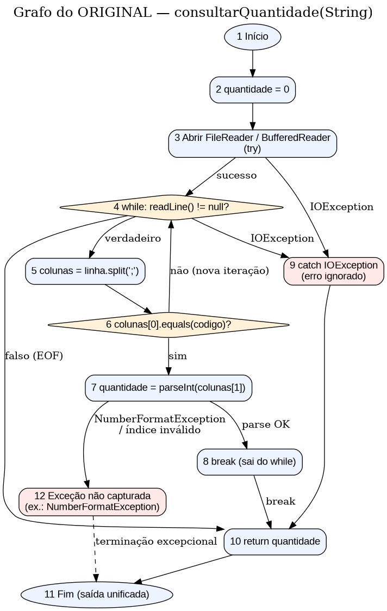
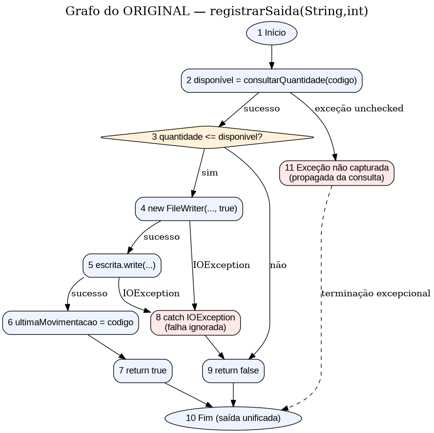

# Atividade de Teste de Caixa Branca — Cenário 2: Estoque por CSV


> **Atividade individual — Cenário 2: Estoque por CSV.**
>
> Este projeto apresenta a análise estática de um código Java, a modelagem dos fluxos de controle, os cálculos da complexidade ciclomática e os testes realizados. Também inclui uma versão revisada do sistema, com melhorias na validação de dados, no tratamento de erros e no gerenciamento de arquivos.

## 1. Introdução e escopo

O sistema lê `estoque.csv` (`codigo;quantidade`), retorna um inteiro para uma consulta e acrescenta uma linha `codigo;quantidade` em `movimentacoes.txt` para uma saída. A análise dos grafos, dos caminhos e de V(G) é **exclusivamente sobre o original**. `getUltimaMovimentacao()` não exige grafo.

## 2. Execução

Requer JDK 17+ e terminal. Na raiz do repositório:

```bash
sh testes/executar.sh
```

No Windows com PowerShell:

```powershell
New-Item -ItemType Directory -Force testes/build | Out-Null
javac -encoding UTF-8 -d testes/build revisado/EstoqueArquivo.java testes/TestesEstoque.java
java -cp testes/build TestesEstoque
```


Os testes utilizam arquivos temporários, sem modificar o código original. Os arquivos `original/EstoqueArquivo.java` e `revisado/EstoqueArquivo.java` **não devem ser compilados juntos**, pois possuem classes com o mesmo nome.


### 2.1. Execução dos testes do código original

Para verificar os problemas encontrados no código original, foi criado o arquivo `testes/TestesLegado.java`. Esse programa permite reproduzir os defeitos sem modificar o código fornecido pelo professor.

No **Windows, utilizando o PowerShell**, execute os comandos abaixo a partir da pasta principal do projeto:

```powershell
New-Item -ItemType Directory -Force testes/build-original | Out-Null
New-Item -ItemType Directory -Force testes/ambiente-original | Out-Null

Set-Content -Path testes/ambiente-original/estoque.csv -Value 'A;10' -Encoding Ascii
Remove-Item -Path testes/ambiente-original/movimentacoes.txt -ErrorAction SilentlyContinue

javac -encoding UTF-8 -d testes/build-original original/EstoqueArquivo.java testes/TestesLegado.java

cd testes/ambiente-original
java -cp ../build-original TestesLegado
cd ../..
```

**Resultados observados na execução:**

- **Estoque inicial:** 10 unidades.
- **Saída negativa:** aceita indevidamente (`true`).
- **Saída com quantidade zero:** aceita indevidamente (`true`).
- **Saída de 2 unidades:** aceita (`true`).
- **Estoque após as saídas:** permanece com 10 unidades.

Esses resultados mostram problemas de validação e a ausência de atualização do saldo no arquivo CSV.

A execução foi registrada em `evidencias/execucao-original.txt`.

**Observação:** as versões `original/` e `revisado/` devem ser compiladas separadamente porque possuem classes com o mesmo nome.

## 3. Análise estática

A aba `CAIXA BRANCO (ESTÁTICO)` em `PLANO_DE_TESTE.xlsx` registra 20 ocorrências (localização, categoria, severidade justificada, consequência, recomendação). Pontos de maior risco: `FileWriter` sem fechamento (linhas 32–35), erro de IO ignorado (22–24 e 36–38), saída negativa ou zero (30), CSV malformado não tratado (17–18), log que não reduz saldo (29–35) e escrita de código com quebra de linha (33). Apesar de nomes relativamente claros, a classe centraliza leitura, autorização e escrita, e não documenta o formato e as falhas. A ordem das linhas e a existência de duplicatas são relevantes para o comportamento legado.

## 4. Grafos de fluxo do código ORIGINAL

### 4.1 consultarQuantidade



Arquivos-fonte: [`diagramas/consultarQuantidade.dot`](diagramas/consultarQuantidade.dot). Nós: 1 entrada; 2 inicialização; 3 abre arquivo; 4 condição do `while` (inclui EOF); 5 `split`; 6 `if` de código; 7 `parseInt`; 8 `break`; 9 `catch IOException`; 10 `return`; 11 saída comum; 12 saída excepcional. As arestas estão desenhadas. A aresta tracejada 12→11 representa **apenas unificação topológica dos términos**, não retorno normal após exceção.

**N = 12, E = 16, P = 1 → V(G) = 16 − 12 + 2 = 6**. Checagem: são cinco alternativas adicionais de desvio em relação ao caminho base: `while`/EOF, `if` de código, exceção de abertura, exceção de leitura e exceção de conversão. A checagem é feita pelas seis trajetórias independentes abaixo, sem confundir um `try` com uma decisão booleana. O desvio 7→12 também representa erro de índice decorrente da linha incompleta. Apenas exceções de IO na abertura/leitura são redirecionadas ao `catch` 9.

**Caminhos básicos (consultarQuantidade)**

| Caminho | Nós na ordem | Condição |
|---|---|---|
| C1 | 1→2→3→4→10→11 | CSV vazio / EOF imediato |
| C2 | 1→2→3→4→5→6→7→8→10→11 | Primeiro registro corresponde e é válido; `break` |
| C3 | 1→2→3→4→5→6→4→10→11 | Registro não corresponde; iteração até EOF |
| C4 | 1→2→3→9→10→11 | Abertura lança IOException |
| C5 | 1→2→3→4→9→10→11 | Leitura lança IOException |
| C6 | 1→2→3→4→5→6→7→12→11 | Quantidade inválida causa exceção não capturada |

### 4.2 registrarSaida



Arquivo-fonte: [`diagramas/registrarSaida.dot`](diagramas/registrarSaida.dot). Nós: 1 entrada; 2 chama `consultarQuantidade`; 3 `if quantidade <= disponivel`; 4 abre arquivo; 5 escreve; 6 atualiza atributo; 7 `return true`; 8 `catch IOException`; 9 `return false`; 10 término unificado; 11 exceção não capturada da consulta. A aresta tracejada 11→10 é de unificação topológica de saída, **não** um retorno `false`.

**N = 11, E = 14, P = 1 → V(G) = 14 − 11 + 2 = 5**. Checagem: quatro desvios adicionais (`if`, exceção na abertura, exceção na escrita e exceção não capturada da consulta) produzem cinco caminhos independentes. O método não contém laço próprio; sua consulta interna pode iterar.

**Caminhos básicos (registrarSaida)**

| Caminho | Nós na ordem | Condição |
|---|---|---|
| R1 | 1→2→3→9→10 | Quantidade solicitada maior que estoque |
| R2 | 1→2→3→4→5→6→7→10 | Quantidade <= estoque; escrita sem falha |
| R3 | 1→2→3→4→8→9→10 | IOException ao abrir log |
| R4 | 1→2→3→4→5→8→9→10 | IOException na escrita |
| R5 | 1→2→11→10 | Consulta lança exceção não capturada (ex.: NumberFormatException) |

**Convenções e exceções:** grafos são intraprocedimentais, com chamada do auxiliar representada por um só nó (R2), portanto não somam V(G) dos dois métodos. IOException na construção do leitor e na leitura é capturada em C9, e IOException na abertura/escrita do log em R8. A conversão de texto em número gera exceção `NumberFormatException` sem captura, transmitida pelo nó R2. Não foram incluídos todos os erros unchecked possíveis da JVM nem uma aresta para cada linha de código potencialmente falha. O `split`, a atribuição e o `return` são tratados como sequenciais. O término unificado é um artifício matemático para usar E−N+2P em um componente conectado com múltiplos modos de saída. As contagens foram conferidas com o próprio arquivo DOT.

## 5. Matriz de casos de teste e resultados

| ID | Método | Caminho original relacionado | Entrada / pré-condição | Resultado esperado | Resultado observado | Situação | Evidência |
|---|---|---|---|---|---|---|---|
| T01 | `consultarQuantidade` | C2 | Produto A; CSV com A;10, B;0 e C;7 | Retornar 10. | A consulta retornou 10 unidades. | **PASSOU** | `evidencias/execucao-local.txt` |
| T02 | `consultarQuantidade` | C3 + C2 | Produto C; CSV com três registros. | Retornar 7. | O produto C foi encontrado com 7 unidades. | **PASSOU** | `evidencias/execucao-local.txt` |
| T03 | `consultarQuantidade` | C1 / C3 | Código Z não cadastrado. | Lançar `IOException`. | O sistema identificou o código inexistente e lançou a exceção esperada. | **PASSOU** | `evidencias/execucao-local.txt` |
| T04 | `registrarSaida` | R2 | Saída de 10 unidades do produto A, com 10 disponíveis. | Retornar `true` e registrar a saída. | A saída foi aceita e a movimentação foi registrada no arquivo. | **PASSOU** | `evidencias/execucao-local.txt` |
| T05 | `registrarSaida` | R1 | Solicitação de 8 unidades, com apenas 7 disponíveis. | Retornar `false`. | A operação foi recusada por falta de estoque. | **PASSOU** | `evidencias/execucao-local.txt` |
| T06 | `registrarSaida` | R2 no original | Saída de 0 unidades. | Lançar `IllegalArgumentException`. | O sistema rejeitou a movimentação com quantidade zero. | **PASSOU** | `evidencias/execucao-local.txt` |
| T07 | `registrarSaida` | R2 no original | Saída de -3 unidades. | Lançar `IllegalArgumentException`. | A quantidade negativa foi identificada e rejeitada. | **PASSOU** | `evidencias/execucao-local.txt` |
| T08 | `consultarQuantidade` | Entrada inválida | Código `null`. | Lançar `IllegalArgumentException`. | O programa rejeitou o código nulo. | **PASSOU** | `evidencias/execucao-local.txt` |
| T09 | `registrarSaida` | Entrada inválida | Código `A;B` e quantidade 1. | Lançar `IllegalArgumentException`. | O código contendo um delimitador inválido foi rejeitado. | **PASSOU** | `evidencias/execucao-local.txt` |
| T10 | `consultarQuantidade` | C6 | CSV contendo `A;abc`. | Lançar `IOException`. | O sistema identificou a quantidade em formato inválido. | **PASSOU** | `evidencias/execucao-local.txt` |
| T11 | `consultarQuantidade` | C6 análogo | CSV com linha sem separador. | Lançar `IOException`. | A linha incompleta foi identificada como inválida. | **PASSOU** | `evidencias/execucao-local.txt` |
| T12 | `consultarQuantidade` | C2 com dado inválido | CSV contendo `A;-1`. | Lançar `IOException`. | O sistema identificou e rejeitou o estoque negativo. | **PASSOU** | `evidencias/execucao-local.txt` |
| T13 | `consultarQuantidade` | C4 | Arquivo `estoque.csv` inexistente. | Lançar `IOException`. | A ausência do arquivo provocou a exceção esperada. | **PASSOU** | `evidencias/execucao-local.txt` |
| T14 | `registrarSaida` | R3 (simulação equivalente) | Destino do log aponta para um diretório. | Lançar `IOException` e preservar o estado. | A gravação falhou e a última movimentação permaneceu inalterada. | **PASSOU** | `evidencias/execucao-local.txt` |
| T15 | `registrarSaida` | R2 | Duas saídas consecutivas. | Registrar duas linhas no arquivo. | As duas movimentações foram registradas no log. | **PASSOU** | `evidencias/execucao-local.txt` |


A saída automatizada foi capturada após execução efetiva do JDK local: **15 passaram e 0 falharam**. Cada teste tem sua entrada e pré-condição descritas; a observação registrada no log é `PASSOU ID`, após asserções Java para o resultado esperado. A evidência é reproduzível via comando da seção 2; no código dos testes há detalhes das verificações. Os resultados desta tabela correspondem à versão **revisada**; o mapeamento C/R é referência ao fluxo **original**, não significa que o código revisado tenha os mesmos caminhos.

### Reprodução de defeitos do legado

Durante a análise do código original, foram identificados problemas na validação das quantidades, no fechamento dos arquivos e no tratamento de erros. Para verificar alguns desses problemas na prática, foi criado e executado o programa `TestesLegado.java`, sem modificar o código fornecido pelo professor. Os testes confirmaram que o sistema aceita saídas negativas e com quantidade zero, além de manter o saldo do CSV inalterado após as movimentações. Outros problemas foram identificados por inspeção estática e não tiveram sua reprodução executada.

### Testes realizados no código original

Para verificar os problemas encontrados na análise estática, executei um programa de testes utilizando o código original, sem realizar alterações nele.

Foi criado um arquivo `estoque.csv` contendo o produto A com 10 unidades disponíveis. Em seguida, foram realizadas três saídas: uma negativa (-3), uma com quantidade zero e outra com 2 unidades.

Os resultados foram os seguintes:

| Teste | Resultado esperado | Resultado observado | Situação |
|---|---|---|---|
| L01 - Saída negativa | Rejeitar a saída de -3 unidades. | O programa aceitou a saída e retornou `true`. | **FALHOU** |
| L02 - Saída zero | Rejeitar uma saída de 0 unidades. | O programa aceitou a movimentação e retornou `true`. | **FALHOU** |
| L03 - Atualização do saldo | Descontar as 2 unidades retiradas do estoque. | A consulta continuou retornando 10 unidades. | **FALHOU** |

Os resultados confirmam que o código original não valida corretamente as quantidades informadas e não atualiza o saldo após registrar uma movimentação.

Na versão revisada, as saídas negativas e com quantidade zero passaram a ser rejeitadas. Entretanto, a atualização do saldo ainda não foi implementada, pois essa versão continua utilizando um registro separado de movimentações. Essa limitação permanece documentada.

**Evidência:** `evidencias/execucao-original.txt`

**Programa utilizado:** `testes/TestesLegado.java`


### Caminhos difíceis de induzir

Uma falha de IO **durante** `readLine()` (C5) ou `write()` depois de abrir o arquivo (R4) não é reproduzível de forma determinística com arquivos locais comuns. Para cobri-los, refatoração adicional poderia injetar `Reader`/`Writer` por fábrica ou interface e usar um `Reader`/`Writer` falso que lança `IOException` exatamente no método desejado; injeção por filesystem controlado ou mocks seria alternativa. O teste T14 provoca falha de abertura do arquivo de movimentações usando um diretório como destino, cobrindo mecanismo equivalente a R3 na versão revisada. Testes atuais **não cobrem C5 nem R4 de forma independente**, e não medem cobertura estrutural com JaCoCo. O `readLine()` do original pode lançar IOException; essa aresta foi modelada mesmo sem teste automatizado específico.

## 6. Refatoração e comparação


| Aspecto | Código original | Código revisado |
|---|---|---|
| Fechamento de arquivos | Abre os arquivos, mas não utiliza `close()`. | Utiliza `try-with-resources` para fechar os arquivos automaticamente. |
| Tratamento de erros | Ignora algumas exceções com `catch` vazio. | Informa os erros utilizando exceções com mensagens mais claras. |
| Validação de entradas | Aceita quantidades negativas e iguais a zero. | Rejeita quantidades menores ou iguais a zero. |
| Leitura do CSV | Não verifica corretamente dados incompletos ou inválidos. | Valida as colunas e verifica se a quantidade é um número válido. |
| Registro das saídas | Retorna `true` sem garantir o fechamento do arquivo. | Fecha o arquivo antes de confirmar que a saída foi registrada. |
| Saldo do estoque | Não desconta as movimentações do CSV. | Continua registrando as saídas separadamente, sem alterar o saldo do CSV. |
| Segurança | Não valida caracteres que podem comprometer o arquivo de movimentações. | Rejeita códigos com caracteres inválidos, reduzindo esse risco. |
| Organização | Utiliza caminhos fixos para os arquivos. | Permite informar os caminhos dos arquivos, facilitando os testes. |
| Testabilidade | É mais difícil testar situações de erro e entradas inválidas. | Possui 15 casos automatizados, executados com sucesso. |

O refatorado tem estrutura distinta, podendo ter V(G) diferente, e **não foi usado** para o cálculo da seção 4. Mais verificações no revisado aumentam a quantidade de decisões, mas tornam as regras explícitas.

## 7. Limitações e questões de integridade

1. Por fidelidade ao escopo, saídas são lançamentos em `movimentacoes.txt`, sem debitar `estoque.csv`. Assim, não há garantia de saldo correto após lançamentos sucessivos. Um sistema real exigiria atualização transacional/atômica e controle de concorrência (ou saldo calculado por razão de movimentações com trava).
2. Não há garantia de atomicidade entre saldo e log, nem proteção contra processos concorrentes.
3. CSV com duplicatas não é rejeitado integralmente; a consulta encerra na primeira correspondência. Linhas depois da correspondência não são analisadas.
4. A versão revisada captura erros de formatação na linha consultada e rejeita linhas anteriores malformadas, mas não valida todo o CSV após encontrar o código.
5. Não foram executados testes com permissões reais de sistema, cenários de disco cheio, falha de escrita após abertura ou fuzzing.


## 8. Conclusão

A análise do código original permitiu identificar problemas relacionados à **validação de dados**, ao **tratamento de exceções** e ao **gerenciamento de arquivos**. A complexidade ciclomática encontrada foi de **V(G) = 6** para `consultarQuantidade()` e **V(G) = 5** para `registrarSaida()`, considerando os fluxos de exceção modelados.

Nos testes realizados com o código **original**, foi possível confirmar que o sistema aceita saídas negativas e com quantidade zero, além de não atualizar o saldo do CSV após as movimentações. Na versão **revisada**, foram implementadas melhorias na validação das entradas, no fechamento dos arquivos e no tratamento dos erros. Os **15 testes automatizados foram executados com sucesso**, sem apresentar falhas.

Apesar das melhorias, o sistema ainda possui limitações, principalmente em relação à **atualização do saldo** e ao **controle de operações simultâneas**. Dessa forma, a atividade mostrou a importância da análise de código e dos testes de caixa branca para identificar falhas e tornar o sistema mais confiável.

## 9. Referências

- Oracle, *The Java Tutorials — The try-with-resources Statement*.
- Oracle, *Java Platform SE Documentation*: `BufferedReader`, `FileWriter`, `Files`, `IOException`.
- McCabe, T. J. (1976), *A Complexity Measure*, IEEE Transactions on Software Engineering.

## 10. Estrutura do repositório

`original/`, `revisado/`, `testes/`, `diagramas/`, `evidencias/`, `PLANO_DE_TESTE.xlsx` e este `README.md`.
